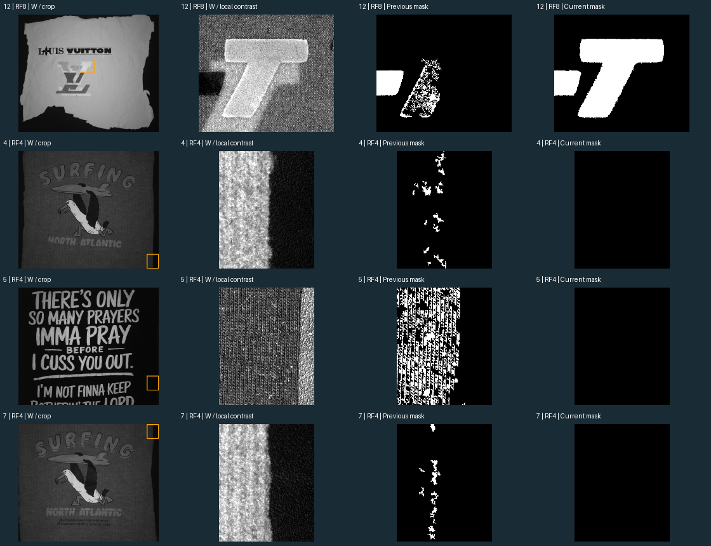
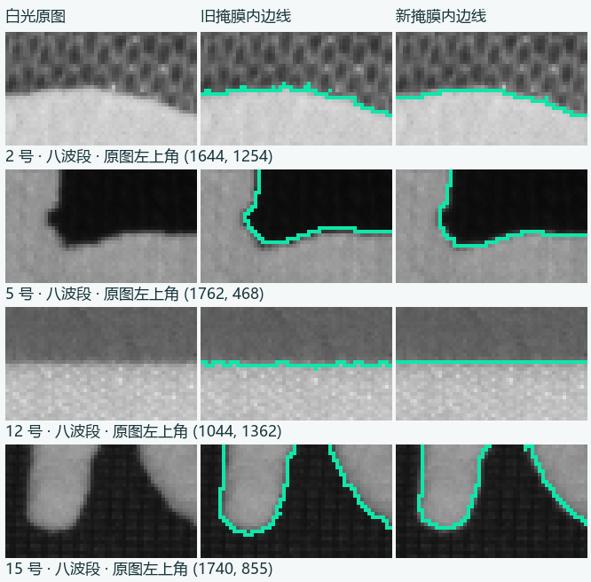
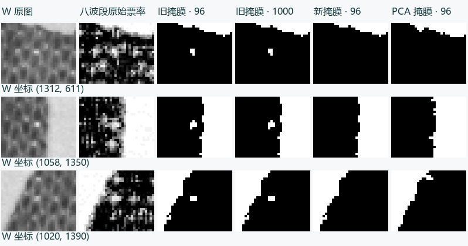

# 无膜片样品复核

对同一批原图、同一模型文件和投票阈值，比较修改前后的**最终掩膜**。本轮调整的是 C++ 的光谱证据与局部底布处理。两条路线各自运行。全部 8 组均生成了原分辨率结果，以下按问题分别复核固定位置。

## 笔画为什么偏粗，怎样核对位置

以 5 号白字的一笔为例。白色墨层与深色衣料之间有几个灰度逐渐变化的像素。原来的森林与融合规则在过渡区靠衣料的一侧便判为前景，笔画两边各多收一部分，中心却没有同样大的位移。八波段在该选区的宽度中位偏差，从原始树票二值化的 +4.23 像素，到旧掩膜的 +2.96 像素，再到加入边缘定位后的 +0.40 像素。另一处显示差异发生在切换非 W 波段时。旧预览直接读取原始 BMP，而掩膜在 W 坐标中；新版让两个画框和轮廓底图一起使用 DLL 本次实际采用的通道位移。

| W 图固定选区 | 八波段宽度偏差中位数，旧 → 新（px） | PCA 宽度偏差中位数，旧 → 新（px） |
|---|---:|---:|
| 2 号下部文字 | +1.52 → +0.08 | +2.90 → +0.36 |
| 5 号上部白字 | +2.96 → +0.40 | +3.41 → +0.68 |
| 12 号标志下部深色笔画 | +1.30 → −0.09 | +2.40 → +0.35 |
| 15 号亮色字区 | +3.49 → +0.75 | +3.66 → +0.91 |

选区由原分辨率坐标固定。在轻度平滑的 W 图上每隔 5 行或列取一次扫描线，筛选可辨的明暗平台，估算亮度中点的亚像素交叉位置。两次交叉的间距是光学笔画宽度，两者均值是笔画中心。每个选区分别有 716、1544、113、584 条参考剖面。CSV 同时记录匹配数和位置误差，避免只看宽度均值而忽略漏匹配。新版四组的中心平均绝对偏差为 0.18～0.42 像素。15 号 PCA 中心偏差从 0.405 变为 0.419 像素，改善主要体现在宽度。本项参照来自实拍 W 图，不能替代原始打印 Alpha 或覆盖同色弱边。[逐阶段数据](../results/无膜片/edge-profiles.csv) · [复测脚本](../evaluation/check_edge_profiles.py)

对全部 8 组无膜片、两条路线复核，16 对原始得分图逐像素一致，前景八连通域数及背景四连通域数均与校正前相同。微小织纹、设计孔洞、独立墨点和细线通过已有回归。空间拓扑相同仍允许像素面积变化。12 号浅色选区的八波段光学参考覆盖少了 14 像素，PCA 少了 63 像素；5 号八波段局部种子 IoU 从 0.455 降到 0.433。现场复核可放大一个笔画，同时看两侧边与中心，并查看界面是否有“波段对齐”复核提示。白光对比不足、缺少可靠两侧参照时保留原有多光谱的判断。

## 2 号露营图案旁的织纹亮点

在 W 图上放大，文字间隙和笔画旁的布面呈现重复的细小亮峰。固定旧版（`f906b7a`）八波段掩膜中 28 个独立小分量的位置，再对照原图及 PCA 掩膜。这些分量面积分别为 5～9 像素，共 167 像素。下表仅统计这 167 个像素在各掩膜中的去留。

| 2 号固定织纹位置 | 保留的块数 | 保留的前景像素 |
|---|---:|---:|
| 旧八波段，去噪上限 96 | 28 | 167 |
| 旧八波段，去噪上限 1000 | 27 | 162 |
| 新八波段，去噪上限 96 或 1000 | 0 | 0 |
| PCA，去噪上限 96 | 0 | 0 |

这些位置的八波段原始得分均值为 223（阈值 112），PCA 原始得分均值也有 189（阈值 104）。PCA 在最终掩膜中清掉了它们；仅比较两幅掩膜不能说明 PCA 森林本身给了低票。旧清理规则对笔画附近的小分量放宽到 5 像素，只要融合证据够高就予以保留。在 96 和 1000 两种设置下，这批点都已经进入筛查范围，因此抬高上限收效很小。

新版对八波段路线中通过初筛、面积至多 16 像素、宽高各至多 5 像素的候选再查周围底布。中心采用候选分量的八通道均值，在外围八块互不重叠的 24 × 24 区域找相似亮峰。一块至少有一半可信布面像素，候选白光比该块布面均值高至少 16 灰度级，并有至少两个像素在八个波段都与候选接近，才算一次支持。各波段容差为 12 灰度级加候选该波段亮度的 18%。至少两块支持才筛除。台面及面积超过 3 像素的前景分量不能提供布面参照。距至少 128 像素的分量两像素以内的小点保留原判，降低误删笔画碎边的风险。该规则只在去噪开启时生效。[连通域与布面比较实现](../native/refine.cpp)

织纹优化这一轮在 2 号默认掩膜中恰好去掉上述 167 个像素，其余像素逐一相同。全 8 组两条路线原始得分、全部 PCA 掩膜和现有稀疏标注处的分类均与旧版一致，12 号的八波段掩膜逐像素一致。两条路线仍分别运行。若新设计本身含有与布纹反光相似的微点，应在原始打印模板或人工标注上复核。用 `python -B evaluation/check_weave.py` 复测这 28 个位置及去噪开关，用 `python -B evaluation/check_refinement.py` 检查独立小印点、细线和设计孔洞。

## 12 号中央标志的浅色笔画

在 W 原图取 x=[1060,1330)、y=[775,1010)。该处的浅色横笔与斜笔在 UV 相对 W 的响应上可分离。用 (UV+8)/(W+8) 的单调灰度映射，做 5×5 中值滤波及局部 Otsu 阈值，得到 17,829 像素的光学参考前景。同一选区的其余 45,621 像素用于检查补笔是否溢出。

| 路线 | 笔画覆盖像素，旧 → 新 | 覆盖率，旧 → 新 | 相邻参考背景误提，旧 → 新 |
|---|---:|---:|---:|
| 八波段 | 4,765 → 17,324 | 26.73% → 97.17% | 0 → 34 |
| PCA 四维 | 17,712 → 17,649 | 99.34% → 98.99% | 263 → 204 |

八波段恢复了横笔和大部分斜笔。相对这份参照仍有 505 像素漏提，其中包含边缘差异。光学参照来自同次拍摄，只适用于这个局部，最终印刷边界仍需原始模板或人工精标确认。

## 4、5、7 号空白背景

按原分辨率 2448×2048 计数。4、7 号取全高的 x=[0,210) 和 [2160,2448) 两侧空白带，包含布边；5 号取全高的 x=[2160,2448) 暗布带。表中每一项为落在固定选区内的前景像素数。对照图只放大了其中一处。

| 样品 | 空白选区面积 | PCA 旧 → 新 | 八波段旧 → 新 |
|---|---:|---:|---:|
| 4 | 1,019,904 | 3,281 → 149 | 213 → 213 |
| 5 | 589,824 | 67,736 → 0 | 0 → 0 |
| 7 | 1,019,904 | 2,278 → 357 | 107 → 107 |

5 号暗布选区内的织纹误提已清除。4、7 号布边仍有零星残留。若图文和底布在各波段具有相似比例，或图案几乎占满画面，底布参照会变得困难。本次复核覆盖现有样品的指定位置；新布料和新图案的放行标准仍需独立实物验证。

## 复算与数据位置

[evaluation/compare_fabric.py](../evaluation/compare_fabric.py) 定义选区和计数方法。[逐项计数 CSV](../results/无膜片/fabric-cases.csv) 同时列出两条路线；[逐组评估](../results/无膜片/验证报告.md) 包含稀疏标注指标和耗时。旧掩膜保存在 results/无膜片/previous-masks/rf{8,4}/<编号>/mask.png，新掩膜在 results/无膜片/rf{8,4}/<编号>/mask.png。先运行 review.py，再运行 compare_fabric.py 即可复算。
